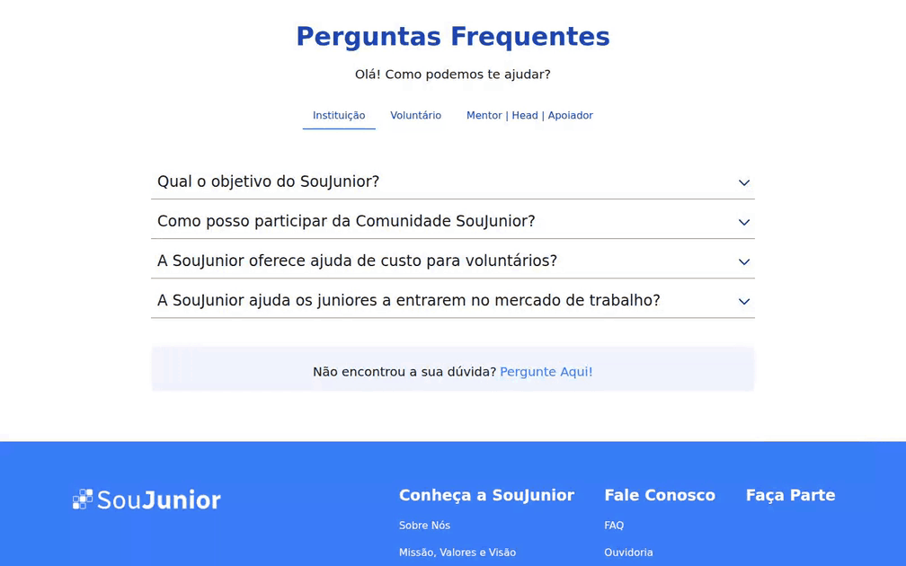

# Testes E2E da SouJunior | Cypress e Playwright

<p>
  
  
  
</p>

Sou **Douglas Antonio**, QA voluntário na SouJunior. Aqui reúno os testes que desenvolvo a partir da minha atuação no projeto: analisar histórias, consultar o Figma, escrever cenários e investigar problemas na experiência de quem usa o site.

A automação acompanha os principais caminhos de participação na SouJunior, da primeira visita à navegação pelas áreas e ao esclarecimento de dúvidas.

| Casos documentados | Frentes funcionais | Páginas internas |
| :---: | :---: | :---: |
| **134** | **13** | **11** |

Os casos incluem automação e revisão manual. Uma mesma regra pode ser exercitada em diferentes rotas e resoluções.

[Demonstração](#demonstração) · [Cobertura](#cobertura) · [Casos de teste](docs/casos-de-teste.md) · [Como executar](#como-executar)

## Demonstração



Gravação da aplicação em localhost, controlada pelo Playwright. O fluxo percorre as três categorias da FAQ e verifica a abertura, o conteúdo e o fechamento das respostas, usando os mesmos Page Objects e dados da suíte.

## Meu trabalho no projeto

- **Análise e cenários:** transformo histórias e referências do Figma em casos com pré-condições, ações e resultados esperados.
- **Investigação de bugs:** documento problemas de navegação, conteúdo e responsividade, com contexto para o time reproduzir e conferir os ajustes.
- **Automação em duas ferramentas:** mantenho os mesmos requisitos em Cypress e Playwright, com testes em português e identificação dos casos nos títulos.
- **Acompanhamento das mudanças:** reviso os roteiros quando o produto muda, como na atualização das áreas da Home e na pausa das iniciativas.

As referências estão no [catálogo de casos](docs/casos-de-teste.md) e nos [registros do projeto da SouJunior](https://github.com/orgs/SouJunior/projects/9/views/1).

## Cobertura

| Frente | O que verifico |
| --- | --- |
| Cabeçalho | Menu, âncoras, acesso ao Stars e navegação mobile |
| Banner principal | Conteúdo, chamada para participação e adaptação ao celular |
| Sobre e Nosso Impacto | Textos, indicadores, margens e leitura em mobile |
| Áreas de atuação | Dez cards, ordem, setas, indicadores e limites do carrossel |
| Páginas internas | Conteúdo e convites para participação nas onze rotas |
| Depoimentos | Oito relatos, fotos, cargos, textos e navegação entre lotes |
| Iniciativas | Ocultação da seção e dos atalhos durante a pausa dos programas |
| Comunidade | Papéis de Júnior, Mentor e Head e acesso ao cadastro |
| Notícias e Eventos | Quatro eventos, vídeos, indicadores mobile e mudança de resolução |
| Apoio | Seção, mascote no desktop, faixa mobile e transições de rolagem |
| FAQ e Ouvidoria | Categorias, respostas, expansão, teclado e acesso à Ouvidoria |
| Identidade visual | Logos, favicon e paleta de cores prevista nas histórias |
| Rodapé | Convite para participação, destino e indicação de interação |

O [catálogo completo](docs/casos-de-teste.md) reúne os roteiros BDD, os dados esperados e as histórias de origem. O identificador de cada caso permite localizar sua implementação nos dois frameworks.

## Como executar

Tenha **Git, Node.js 22 ou superior e npm** instalados. A aplicação e os testes ficam em repositórios separados e devem rodar em dois terminais.

### 1. Subir o site — primeiro terminal

```bash
git clone https://github.com/SouJunior/site-webapp-v2.git
cd site-webapp-v2
npm ci --legacy-peer-deps --ignore-scripts
npm start
```

Aguarde a compilação e abra [http://localhost:3000](http://localhost:3000). Mantenha esse terminal aberto durante os testes.

Essa preparação foi conferida com o commit [6bcced3](https://github.com/SouJunior/site-webapp-v2/commit/6bcced364a0d8a33158ec3af0a1b2d052ed91f54) da aplicação. Nessa versão, `--legacy-peer-deps` permite instalar as dependências com o lockfile existente; `--ignore-scripts` dispensa os scripts de instalação das ferramentas de testes do site.

### 2. Preparar a automação — segundo terminal

Em outro terminal, na pasta em que deseja guardar o projeto:

```bash
git clone https://github.com/DouglasAntoni0/Testes-E2E-SouJunior.git
cd Testes-E2E-SouJunior
npm ci
npx playwright install chromium
```

Copie **.env.example** para um novo arquivo chamado **.env**, na raiz do repositório de testes. O conteúdo para o ambiente local é:

```env
BASE_URL=http://localhost:3000
```

Para testar outro ambiente, ajuste o endereço em **.env**. Os specs usam a URL centralizada na configuração.

### 3. Executar os testes

No terminal do repositório de automação, escolha o comando:

| Comando | Uso |
| --- | --- |
| `npm run test:e2e` | Executar Cypress e Playwright em sequência |
| `npm run cypress:run` | Executar a suíte Cypress |
| `npm run cypress:open` | Abrir a interface do Cypress |
| `npm run playwright:test` | Executar a suíte Playwright |
| `npm run playwright:headed` | Executar Playwright com o navegador visível |
| `npm run playwright:list` | Listar os cenários do Playwright |

No Linux, `npx playwright install --with-deps chromium` também instala as dependências de sistema necessárias ao navegador.

## Organização e manutenção

```text
cypress/
  e2e/                    Testes por funcionalidade
  support/pages/          Page Objects do Cypress
  support/validacoes.js   Verificações recorrentes
tests/playwright/
  *.spec.js               Testes por funcionalidade
  pages/                  Page Objects do Playwright
  apoio/validacoes.js     Verificações recorrentes
shared/                   Dados esperados e medidas de layout
docs/casos-de-teste.md     Catálogo BDD e rastreabilidade
docs/midia/               Demonstração da automação
scripts/                  Execução conjunta das suítes
```

Uso seletores por nome acessível, papel, texto, destino e marcação HTML estável. Os Page Objects reúnem a navegação que se repete; os dados de referência ficam em **shared/**, independentes do código da aplicação.

Nos serviços externos, verifico o destino e a forma de abertura do link. Acessibilidade entra em interações de teclado, nomes acessíveis e estados ARIA; a comparação visual com o Figma tem roteiros de revisão manual. As medidas de layout consideram a largura útil do navegador, incluindo a barra de rolagem.

Quando um requisito muda, reviso o caso, os dados e as duas implementações juntos. Uma diferença encontrada na tela é investigada antes de alterar a expectativa do teste.

---

**Douglas Antonio — QA e voluntário na SouJunior**

[LinkedIn](https://www.linkedin.com/in/douglas-antonio-qa/) · [GitHub](https://github.com/DouglasAntoni0) · [Portfólio](https://douglasqa.netlify.app)
